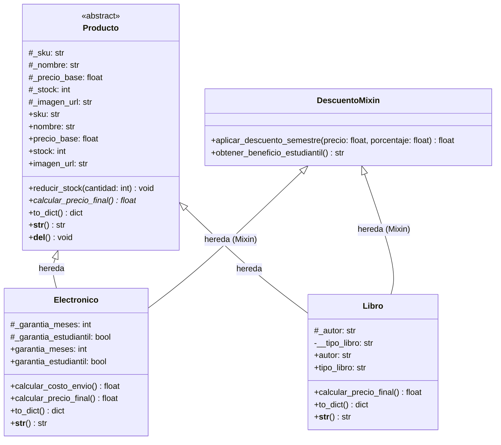
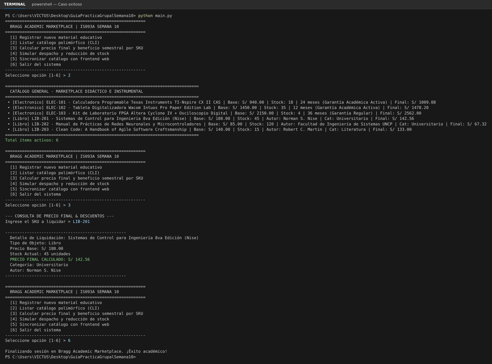
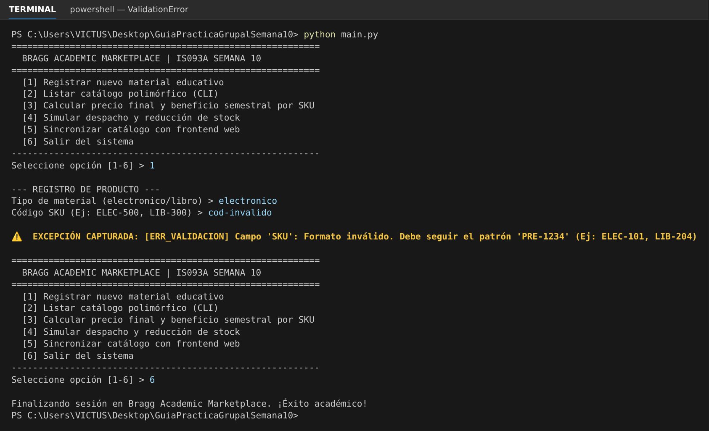
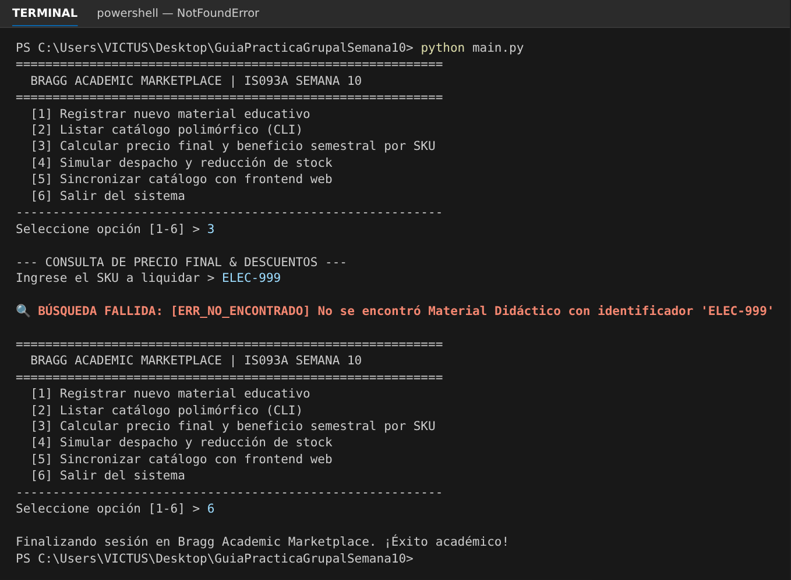

# Universidad Nacional del Centro del Perú
### Facultad de Ingeniería de Sistemas
**Asignatura:** Desarrollo de Aplicaciones Web (IS093A)  
**Semana:** 10 — Lenguaje Python: Sintaxis, POO, Excepciones y Modularización  
**Equipo de Trabajo:**
- Gago Uribe (Arquitecto POO & Desarrollador Frontend/Diseño)
- Huamanlazo Pariona (Ingeniero de Excepciones, QA & Documentador)

---

## 0. Requisitos y Ejecución
- Python **3.12+** (se usa `typing.override`).
- Instalar herramientas de QA: `pip install -r requirements.txt`
- Ejecutar el CLI: `python main.py`

---

## 1. Dominio Seleccionado: Marketplace E-Learning (Físicos y Digitales)
Plataforma orientada al aprovisionamiento de material didáctico universitario e instrumentación de laboratorios para estudiantes de la Facultad de Ingeniería de Sistemas de la UNCP.

El catálogo administra:
1. **Instrumental y Gadgets (`Electronico`):** Calculadoras programables CAS, kits FPGA, tabletas digitalizadoras de laboratorio.
2. **Bibliografía Académica (`Libro`):** Textos universitarios, manuales de laboratorio y obras literarias.

---

## 2. Diagrama de Clases UML



---

## 3. Justificación Técnica: MRO y Decisión Arquitectural

### 3.1. Algoritmo C3 Linearization (MRO)
Python resuelve los métodos y atributos en herencia múltiple mediante el algoritmo de linealización C3. Para nuestras clases derivadas, la secuencia exacta es:

```text
Electronico.__mro__ = (Electronico, Producto, DescuentoMixin, object)
Libro.__mro__       = (Libro, Producto, DescuentoMixin, object)
```

**Beneficio práctico:**  
Permite que tanto `Electronico` como `Libro` accedan a los métodos transversales de deducción de inicio de semestre definidos en `DescuentoMixin` sin duplicar lógica y sin caer en ambigüedades del problema del diamante, pues `DescuentoMixin` no redefine métodos estructurales de `Producto`.

### 3.2. ¿Por qué Herencia vs. Composición en este caso?
- **Herencia para `Producto` -> `Electronico` / `Libro`:**  
  Se cumple estrictamente la relación jerárquica *is-a* (un libro *es un* producto educativo, un gadget *es un* producto educativo). Ambos comparten identidad de inventario: SKU, denominación, precio base y existencias.
- **Mixin para `DescuentoMixin`:**  
  A diferencia de una composición rígida (inyectar una clase `MotorDescuentos`), el mixin aporta capacidades de cálculo polinómico directo sin necesidad de instanciación externa adicional, manteniendo la interfaz nativa del modelo.

---

## 4. Encapsulamiento y Validaciones de Dominio

Los atributos no se manipulan directamente:
- `_sku`: Validado mediante expresiones regulares (`^[A-Z]{2,4}-\d{3,6}$`).
- `_precio_base`: Rango controlado de S/ 0.50 a S/ 25,000.00.
- `_stock`: Rango de 0 a 10,000 unidades. Dispara excepción ante sobregiro de despachos.
- `__tipo_libro`: Atributo estrictamente privado con *name-mangling* que restringe los valores a `"universitario"` o `"literatura"`.

---

## 5. Evidencias de Ejecución

### 5.1. Caso Exitoso (Ruta Feliz: Listado y Liquidación Polimórfica)
```text
  BRAGG ACADEMIC MARKETPLACE | IS093A SEMANA 10
[1] Registrar nuevo material educativo
[2] Listar catálogo polimórfico (CLI)
[3] Calcular precio final y beneficio semestral por SKU
...
Seleccione opción [1-6] > 2

================================================================================
  CATÁLOGO GENERAL - MARKETPLACE DIDÁCTICO E INSTRUMENTAL
================================================================================
 • [Electronico] ELEC-101 - Calculadora Programable Texas Instruments TI-Nspire CX II CAS | Base: S/ 940.00 | Stock: 18 | 24 meses (Garantía Académica Activa) | Final: S/ 1009.08
 • [Electronico] ELEC-102 - Tableta Digitalizadora Wacom Intuos Pro Paper Edition Lab | Base: S/ 1450.00 | Stock: 35 | 12 meses (Garantía Académica Activa) | Final: S/ 1478.20
 • [Electronico] ELEC-103 - Kit de Laboratorio FPGA Altera Cyclone IV + Osciloscopio Digital | Base: S/ 2150.00 | Stock: 4 | 36 meses (Garantía Regular) | Final: S/ 2562.00
 • [Libro] LIB-201 - Sistemas de Control para Ingeniería 8va Edición (Nise) | Base: S/ 180.00 | Stock: 45 | Autor: Norman S. Nise | Cat: Universitario | Final: S/ 142.56
 • [Libro] LIB-202 - Manual de Prácticas de Redes Neuronales y Microcontroladores | Base: S/ 85.00 | Stock: 120 | Autor: Facultad de Ingeniería de Sistemas UNCP | Cat: Universitario | Final: S/ 67.32
 • [Libro] LIB-203 - Clean Code: A Handbook of Agile Software Craftsmanship | Base: S/ 140.00 | Stock: 15 | Autor: Robert C. Martin | Cat: Literatura | Final: S/ 133.00
================================================================================
Total ítems activos: 6
```



### 5.2. Excepción 1 Capturada: `ValidationError` (Formato de SKU o Precio Fuera de Rango)
```text
--- REGISTRO DE PRODUCTO ---
Tipo de material (electronico/libro) > electronico
Código SKU (Ej: ELEC-500, LIB-300) > cod-invalido

⚠️  EXCEPCIÓN CAPTURADA: [ERR_VALIDACION] Campo 'SKU': Formato inválido. Debe seguir el patrón 'PRE-1234' (Ej: ELEC-101, LIB-204)
```



### 5.3. Excepción 2 Capturada: `NotFoundError` (Búsqueda de Material Inexistente)
```text
--- CONSULTA DE PRECIO FINAL & DESCUENTOS ---
Ingrese el SKU a liquidar > ELEC-999

🔍 BÚSQUEDA FALLIDA: [ERR_NO_ENCONTRADO] No se encontró Material Didáctico con identificador 'ELEC-999'
```



---

## 6. Ejecución de Pruebas Automatizadas

Para validar la totalidad de casos de prueba unitarios:

```bash
python -m unittest discover tests/
```

Salida esperada:
```text
.............
----------------------------------------------------------------------
Ran 13 tests in 0.002s

OK
```